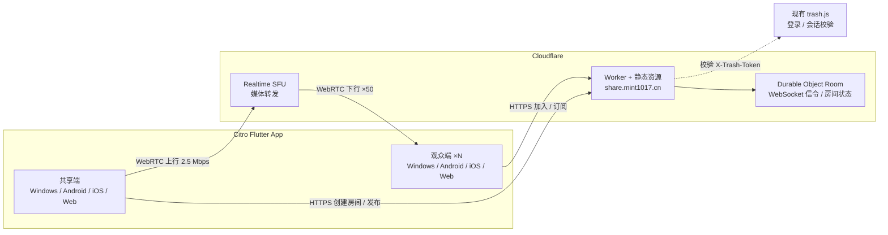

# Citro 屏幕共享 Cloudflare 独立部署方案

**文档版本**：v1.0  
**日期**：2026-11-14  
**适用工程**：`C:\webflu\Citro`（App 版本 `2.7.0+2700`，引擎 Flutter `3.47.7`，Windows / Android / iOS / Web）  
**目标**：把原有 `demo.piik.tv` 第三方屏幕共享页，替换为 Citro 自研屏幕共享；音视频媒体全部走 Cloudflare，自有服务器只负责登录、房间和信令。

> **实施状态（2026-11-14）**：主体已完成并跑通测试，本文档中带有「✅ 已实现」的条目与代码一致。
> 未完成：自定义域名接入（账号还没有 `chimu-claw.xyz` 的 zone）、iOS 广播扩展、系统 PiP、
> 大陆网络实测矩阵、50 人压测。详见 §0.1。

---

## 0. 一页结论

| 项目 | 结论 |
|---|---|
| 原实现 | `demo.piik.tv` 第三方网页，用应用内 WebView 打开；仓库中没有自研媒体链路。✅ 已被本方案替换 |
| 推荐架构 | Flutter 原生屏幕共享页 + Cloudflare Realtime SFU + Workers / Durable Objects 信令 |
| 屏幕采集 | `flutter_webrtc` 1.6.3：Windows 原生采集、Android MediaProjection、iOS ReplayKit、Web `getDisplayMedia` |
| 观众规模 | 50 人以内；1 对多、1 对 1、多对多统一用「房间 + track」模型 |
| 媒体带宽 | 主持人上行约 2.5 Mbps（720p30）；Cloudflare 下行 50 × 2.5 Mbps；自有服务器几乎不占带宽 |
| 成本 | 720p / 2.5 Mbps 约 56 GB/小时；每月前 1,000 GB 免费，超出 $0.05/GB |
| 最大风险 | Cloudflare Realtime 没有中国大陆节点；必须先用真实的大陆三大运营商网络做 POC |
| 交付节奏 | POC 1 周 → MVP 4~6 周 → iOS / 多端完善 2~3 周 |

**一句话**：这是一套「客户端原生采集 + Cloudflare SFU 转发 + Worker 管房间」的方案。它能把 50 路观看的出口带宽从自有服务器彻底移走，同时保留 Citro 自己的登录、房间和 UI。

### 0.1 实施状态（2026-11-14）

| 部分 | 状态 | 位置 |
|---|---|---|
| Worker + Durable Object 信令 | ✅ 已实现，21 个用例全通过 | `screen-share/src/` |
| 网页观众端 | ✅ 已实现，本地浏览器 e2e 验证过 | `screen-share/public/index.html` |
| Flutter 共享端 + 观看端 | ✅ 已实现，30 个用例全通过 | `flutter/lib/screen_share/` |
| Android 前台服务 / MediaProjection | ✅ 已实现 | `MainActivity.kt`、`ScreenCaptureService.kt` |
| iOS 广播扩展 | ❌ 未实现（需要 macOS + Xcode） | — |
| 系统 PiP | ❌ 未实现，已用应用内小窗代替 | `widgets/mini_window.dart` |
| 自定义域名 `share.mint1017.cn` | ✅ 已接入并验证（zone active、页面 / 接口 200） | 运维手册 §4.2 |
| 备用域名 `share.chimu-claw.xyz` | ⚠️ zone / 绑定 / 证书都在，但注册局委派回到华为云，公网不可解析 | 运维手册 §4.4 |
| 生产部署 | ✅ 已部署（`wrangler.toml` 两个自定义域路由都在） | — |
| 大陆网络实测矩阵 | ❌ 未执行 | 测试计划 §9 |
| 50 人压测 | ❌ 未执行 | 测试计划 §8 |

---

## 1. 现状与约束

### 1.1 现有屏幕共享入口

| 文件 | 行号 | 现状 |
|---|---|---|
| `flutter/lib/data/resources.dart` | 283-288 | `ToolItem`「屏幕分享」，desc「自建屏幕共享，可语音文字沟通」，url `https://share.mint1017.cn/` ✅ |
| `flutter/lib/pages/web_home.dart` | 191-198 | 首页工具卡 `openCitroPage(context, 'https://share.mint1017.cn/', title: '屏幕分享')` ✅ |
| `flutter/lib/pages/res_page.dart` | 371-409 | 资源页顶部快捷工具从 `kTools` 按 name 取，URL 来自 `resources.dart` |
| `flutter/lib/widgets/negative_screen.dart` | 106-121 | 负一屏固定 5 项含「屏幕分享」，同样从 `kTools` 取 |
| `flutter/lib/pages/in_app_web_native.dart` | 282-295 | 站内 WebView 白名单 `host == 'chimu-claw.xyz' \|\| host.endsWith('.chimu-claw.xyz')`，另加 `mint1017.cn` / `.mint1017.cn` |
| `flutter/lib/pages/in_app_web_web.dart` | 5-11 | Web 构建下 `openInAppPage` 用系统浏览器打开新标签 |

结论：

1. 四个入口都已指向 `share.mint1017.cn`，`demo.piik.tv` 已删除。
2. `pubspec.yaml` 已加入 `flutter_webrtc: ^1.6.3`；Web 端仍然不能用（该版本没声明 web 平台），观众走网页。
3. 自定义域名已接入 Cloudflare：`mint1017.cn` 的 zone 已 active，`share.mint1017.cn` 页面与 `/api/health` 均返回 200。`share.chimu-claw.xyz` 的 zone 也曾建好，但其注册局委派又回到华为云 DNS，公网不可解析，故当前对外域名是 `share.mint1017.cn`（见运维手册 §4.4）。

### 1.2 为什么不能继续用 WebView 做屏幕共享

| 平台 | WebView 内 `getDisplayMedia` | 结论 |
|---|---|---|
| Windows WebView2 | 支持，但需要 WebView2 1.0.2903.40+ 的 `ScreenCaptureStarting` 事件；当前本地 `flutter_inappwebview_windows` 没有接这个事件 | 有兼容风险，不能作为唯一方案 |
| Android WebView | 不原生支持 `getDisplayMedia`，需要自己写 MediaProjection 适配 | 不能靠网页发起共享 |
| iOS WKWebView / Safari | 不支持 `getDisplayMedia` | 不能靠网页发起共享 |
| 桌面 Chrome / Edge | 支持 `getDisplayMedia` | 只能覆盖浏览器场景 |

因此，WebView 方案最多只能覆盖 Windows 端共享，Android 和 iOS 端无法发起屏幕共享。要真正「在已有 App 内实现」，必须使用 Flutter 原生采集，不能只是换一个网页 URL。

### 1.3 带宽问题量化

按 720p / 30fps / H.264 / 约 2.5 Mbps 估算（与 `share_quality.dart` 的 720p30 档一致）：

- 1 位主持人上行：约 2.5 Mbps；
- 50 位观众同时观看：50 × 2.5 Mbps = 125 Mbps 持续出口；
- 1 小时流量：125 Mbps × 3,600 秒 ÷ 8 ÷ 1,000 ≈ 56 GB；
- 2 小时一场：约 112 GB。

如果自建媒体服务器，这意味着持续 125 Mbps 的独享出口；普通云服务器或家用宽带都扛不住，还会受并发、转码和 NAT 影响。Cloudflare SFU 方案中，主持人只上行 2.5 Mbps，Cloudflare 负责复制给 50 个观众，自有服务器只处理几 KB/s 的信令和房间接口。

### 1.4 需求清单

| 编号 | 需求 | 说明 |
|---|---|---|
| R1 | 基于现有 Flutter App | 不另做一个独立 App，不要求用户跳转外部浏览器 |
| R2 | 多端支持 | Windows / Android / iOS / Web 均可作为观众端；共享端至少覆盖 Windows 与 Android，iOS 第二阶段 |
| R3 | 共享模式 | 1 对多（50 人以内）、1 对 1、多对多 |
| R4 | 基本质量 | 720p / 30fps，端到端延迟目标 < 800 ms，音频 < 300 ms |
| R5 | 登录体系 | 复用 Citro 现有账号 / `X-Trash-Token`，不新建账号体系 |
| R6 | 带宽 | 媒体不经过 `chimu-claw.xyz` 自有服务器 |
| R7 | 地区 | 中国大陆为主，需要专门做大陆网络验证 |
| R8 | 可控性 | 房间创建、加入、成员管理、结束共享、观看人数、异常日志均由 Citro 自己掌握 |

---

## 2. 方案选型

### 2.1 候选方案对比

| 方案 | 适合场景 | 成本 | 优点 | 缺点 | 结论 |
|---|---|---|---|---|---|
| **Cloudflare Realtime SFU** | 1 对多、1 对 1、多对多 | $0.05/GB 出口；每月 1,000 GB 免费 | 标准 WebRTC；浏览器 / 原生均可接；自定义 UI；媒体不过自有服务器 | 需要自己写信令；无中国大陆节点 | **推荐主方案** |
| Cloudflare Stream Live WebRTC | 单向直播、 webinar | $1 / 1,000 交付分钟 | WHIP/WHEP 简单；亚秒延迟；可支撑数千观众 | 只能单向；WebRTC 暂不支持录制 / 回放 HLS / Simulcast；不适合多人互动 | 可选，大会场备用 |
| Cloudflare RealtimeKit | 快速做会议 | $0.002/参与者/分钟，含 10,000 分钟/月 | 托管 UI Kit、屏幕共享组件、录制到 R2 | Flutter 包被 pub.dev 标 discontinued；仅 Android/iOS，无 Windows | 不推荐作为核心 |
| 自建 mediasoup / Janus | 完全可控 | 服务器带宽 + 运维 | 无按量费用 | 100 Mbps 出口成本高；运维复杂；本末倒置 | 不采用 |
| 腾讯云 TRTC / 声网 Agora | 大陆体验优先 | 按分钟计费 | 大陆节点、弱网优化成熟 | 非 Cloudflare；需要另一套账号和 SDK | 大陆兜底方案 |

### 2.2 推荐组合

**主方案：Cloudflare Realtime SFU。**

理由：

- 它解决的核心问题是「主机只上行 1 路、Cloudflare 复制给最多 50 路」，正好匹配「服务器带宽不够」的诉求；
- 它不限制客户端形态，Flutter 用 `flutter_webrtc` 直接接标准 WebRTC；
- 它不绑定 UI，Citro 可以完全自定义房间页、共享页和品牌；
- 价格透明，按出口 GB 计费，前期 1 TB 免费足够验证。

**备用方案：腾讯云 TRTC / 声网 Agora。** 如果大陆真实网络 POC 出现大面积卡顿、花屏或无法建连，保留一个「媒体提供方」抽象层，切换到国内实时音视频云。Cloudflare 继续承担静态页、房间 API 和海外用户。

**不建议在本期使用 Cloudflare Stream Live WebRTC 作为主方案**：它是一对多单向直播，不适合 1 对 1 和多对多；而且 WebRTC 模式不支持录制和 HLS 回放，后续要加录制会比较被动。

### 2.3 为什么是 SFU，不是 P2P / Mesh

- 1 对 50 如果走 P2P Mesh：主持人要上行 50 × 2.5 Mbps = 125 Mbps，且每个观众还要分别接收其他 49 路，浏览器和手机都扛不住。
- SFU（Selective Forwarding Unit）只做转发：主持人上行 1 路到 Cloudflare，Cloudflare 再分别下行给 50 个观众；主持人带宽从 125 Mbps 降到 2.5 Mbps。
- 1 对 1 也可以用同一套 SFU，代码路径统一，后续加多对多不需要换架构。

### 2.4 总体架构图



---

## 3. 总体架构设计

### 3.1 组件职责

| 组件 | 部署位置 | 职责 |
|---|---|---|
| Citro Flutter App | 用户设备 | 屏幕采集、预览、WebRTC 发布 / 订阅、视频渲染、房间 UI |
| `share.mint1017.cn` Worker | Cloudflare | 托管静态页；提供房间、加入、发布、订阅、踢人、结束等 REST API；用 App Secret 调 SFU API |
| Durable Object `Room` | Cloudflare | 每个房间一个实例；WebSocket 广播；成员列表、发布者列表、观看人数、限流、房间生命周期 |
| Cloudflare Realtime SFU | Cloudflare | 转发音视频 track；不保存媒体；不参与业务逻辑 |
| `trash.js` | 自有服务器 | 现有登录会话校验；可选：直接签发房间 Token 的接口 |
| R2（可选） | Cloudflare | 后续录制文件存储；本期不做 |

### 3.2 房间模型

一个房间对应一个 Durable Object 实例，核心字段：

| 字段 | 类型 | 说明 |
|---|---|---|
| `roomId` | string | 6 位数字 + 6 位十六进制随机后缀，例如 `839201-a1b2c3` |
| `title` | string | 房间标题 |
| `roomType` | enum | `one_to_many` / `one_to_one` / `multi_party` |
| `hostUid` | string | 主持人用户 ID |
| `quality` | object | 主持人选中的画质，新加入的共享者默认沿用 |
| `maxViewers` | int | 默认 50，最大 50 |
| `status` | enum | `waiting` / `live` / `ended`；当前实现里房间创建后一直是 `waiting`，只在结束 / 到期时置 `ended`，没有进入 `live` 的分支 |
| `createdAt` | timestamp | 创建时间 |
| `expiresAt` | timestamp | 默认 12 小时自动结束 |
| `members` | map | `uid → Member`，**一个 map 同时承担发布者和观众**，见下 |

> 实现里没有分开的 `publishers` / `viewers` 数组：一个人可以既是观众又是发布者，
> 用两个数组会立刻出现「同一个人要在两处同步」的问题。`Member` 字段：
> `uid`、`name`、`role`（`host` / `publisher` / `viewer`）、`sfuSessionId`、
> `tracks`（正在发布的 track）、`joinedAt`、`online`。

角色规则：

- **主持人**：创建房间，默认拥有发布权；可以结束房间、踢人；
- **观众**：只能订阅；默认没有发布权（`one_to_many` 房间里非主持人要等自己已有 track 或主持人把角色提为 `publisher`）；
- **多对多**：观众可以直接发起共享，不需要主持人授予；同时共享的路数没有上限，客户端把全部发布者渲染成横向列表，主画面取第一个有 screen 的人；
- **1 对 1**：双方都可以直接发起共享，同一时刻不限制只有一方共享，双方可以同时发布。

> 当前实现没有「房间密码」和「锁定房间」的字段或接口；`request_publish` / `grant_publish`
> 事件在 DO 里被显式忽略（收到即丢弃）。发布权的判定在 Worker 的 `canPublish`：
> token 的 `role` 是 `host` 或 `publisher`，或者房间不是 `one_to_many`，或者该成员
> 已经有 track —— 任一成立即可发布。所以 `one_to_one` / `multi_party` 房间对任何成员
> 直接放行；只有 `one_to_many` 限制为「主持人或已有 track 的成员」，被拒绝时返回
> 403「当前只有主持人可以共享」。

### 3.3 核心信令流程

#### 主持人发布屏幕

1. App 调 `POST /api/rooms`，带 `X-Trash-Token`；Worker 校验登录态，创建 `Room` DO，返回 `{roomId, roomCode, roomToken, iceServers, expiresAt, room, members}`。
2. App 用 `flutter_webrtc` 采集屏幕，创建 `RTCPeerConnection`，`addTransceiver(track, direction: sendonly)`，`createOffer` / `setLocalDescription`。
3. App 调 `POST /api/rooms/{roomId}/publish`，body 包含 `sdp`、`type: offer` 和 `tracks`（`[{name, kind, mid}]`，`tracks` 缺省时按 `[{name:'screen', kind:'video'}]` 处理）。Worker 调 SFU：
   - `POST /apps/{appId}/sessions/new` 创建发布 session；
   - `POST /apps/{appId}/sessions/{sessionId}/tracks/new`，body `{sessionDescription:{type:'offer',sdp}, tracks:[{location:'local', mid, trackName, kind}]}`，其中 `mid` 取客户端上报的 `transceiver.mid`（缺省才回落成序号 `String(i)`），不能硬编码 `'0'`；
   - 返回 SFU 的 answer SDP 和 `sessionId`。
4. App `setRemoteDescription(answer)`，ICE 建立后开始推流。
5. App 连 `wss://share.mint1017.cn/api/rooms/{roomId}/ws?token=...`，发 `publish_state`（带上自己的 track 列表）；DO 的 `onPublishState` 只整体替换该成员的 track 列表并持久化，**不广播**。`publisher_joined` 是在第 3 步 Worker 调 `/internal/publish` 时（首次拿到 session 且有 track）广播的；后续 track 变化走 `track_added` / `track_removed`。

#### 观众订阅

1. App 调 `POST /api/rooms/{roomId}/join`，带 `X-Trash-Token` 或房间码；Worker 返回 `roomToken`、`iceServers`、`room`、`members`、`chatHistory`。
2. App 连 WebSocket，收到 `publisher_joined {uid, name, sessionId, tracks}`。
3. App 调 `POST /api/rooms/{roomId}/subscribe`，body 包含 `publisherSessionId`、`trackName`。Worker 调 SFU：
   - `POST /apps/{appId}/sessions/new` 创建接收 session；
   - `POST /apps/{appId}/sessions/{sessionId}/tracks/new`，body `{tracks:[{location:'remote', sessionId:publisherSessionId, trackName:'screen'}]}`；
   - 返回 SFU 的 offer SDP。
4. App `setRemoteDescription(offer)`，`createAnswer`，`setLocalDescription(answer)`。
5. App 把 answer 发给 Worker，Worker 调 `PUT /apps/{appId}/sessions/{sessionId}/renegotiate` 提交。
6. `pc.ontrack` 拿到远端视频 track，绑定到 `RTCVideoRenderer` 渲染。

> 关键实现约束：发布与接收使用**不同的 SFU session**；同一个 session 的变更必须串行，必须等上一个 SDP 交换完成后再发下一个 mutation；不同 session 可以并行。

### 3.4 REST API 设计

| 方法 | 路径 | 作用 | 鉴权 |
|---|---|---|---|
| POST | `/api/rooms` | 创建房间 | `X-Trash-Token` |
| GET | `/api/rooms/{roomId}` | 查询房间信息 | 房间 token |
| POST | `/api/rooms/{roomId}/join` | 观众加入，签发 roomToken | `X-Trash-Token` / 房间码 |
| POST | `/api/rooms/{roomId}/publish` | 发布屏幕，创建发布 session | 房间 token（`canPublish` 判定，见 §3.2） |
| POST | `/api/rooms/{roomId}/subscribe` | 订阅某路屏幕，创建接收 session | 房间 token |
| POST | `/api/rooms/{roomId}/answer` | 提交订阅 answer，触发 renegotiate | 房间 token |
| POST | `/api/rooms/{roomId}/leave` | 离开房间，关闭 session | 房间 token |
| POST | `/api/rooms/{roomId}/kick` | 主持人踢人（Worker → DO `/internal/kick`） | 主持人 token |
| POST | `/api/rooms/{roomId}/end` | 结束房间，断开所有连接 | 主持人 token |
| GET | `/api/ice` | 获取短期 TURN 凭证 | 房间 token |
| WS | `/api/rooms/{roomId}/ws` | 房间事件通道 | 房间 token |
| GET | `/api/health` | 健康检查 | 无 |

### 3.5 WebSocket 事件

| 事件 | 方向 | 说明 |
|---|---|---|
| `hello` | Server → Client | 连接成功，返回自己（`self`）、`room`、`members`、`chatHistory` |
| `member_joined` / `member_left` | Server → Client | 成员上下线（含房主重连） |
| `publisher_joined` | Server → Client | 有人开始共享，附带 `uid`、`name`、`sessionId`、`tracks` |
| `publisher_left` | Server → Client | 共享结束或发布者断开，附带 `uid`、`sessionId` |
| `track_added` / `track_removed` | Server → Client | 单个 track 变化（例如主持人加了麦克风） |
| `viewer_count` | Server → Client | 当前观看人数变化（**含房主**，所以单人房是 1） |
| `quality_changed` | Server → Client | 主持人切换了画质 |
| `room_ended` | Server → Client | 主持人结束 / 房间到期 / 房主宽限超时，带 `reason` |
| `chat` | Server → Client | 聊天消息 |
| `error` | Server → Client | 错误码和消息 |
| `ping` / `pong` | 双向 | 心跳，30 秒一次 |

> `publisher_joined` 的字段是 `sessionId` + `tracks`（数组），不是 `publisherSessionId` + `trackName`：
> 一路共享可以同时携带屏幕和麦克风两个 track，订阅时要按 `mid` 对应回去。

### 3.6 断线与重连

- SFU session 断开后有 **30 秒复用窗口**；客户端在这 30 秒内重连可复用原 session，超过则重新创建；
- 观众断线重连时**不需要重新 join**：房间 token 还在有效期内，`RoomWs` 只重开 socket；重连后服务端重推 `hello` 快照，客户端按快照里的 `members` 补齐发布者并重新订阅；
- 主持人断线 5 分钟内房间保持原状（`status` 不变，仍是 `waiting`），超过 5 分钟自动结束，避免僵尸房间；
- 移动端切前后台、Wi-Fi / 4G 切换时，监听 `RTCPeerConnection.onConnectionState`；当前实现只处理 `failed`，调 `pc.restartIce()` 重启 ICE，没有 `disconnected` 的 5 秒等待，也不重建整条链路（计划：`disconnected` 先等 5 秒再决定，`failed` 立即重建）；
- WebSocket 断线用指数退避重连：1s、2s、4s、8s、16s，之后固定 30s。

---

## 4. Cloudflare 配置与实现

### 4.1 开通 Realtime

1. 登录 Cloudflare Dashboard → **Realtime** → **Create App**，记下 `App ID` 和 `App Secret`。
2. 在 Realtime 的 TURN 页面创建一个 **TURN Key**，记下 `TURN Key ID` 和 `TURN Key Secret`。
3. 确认账号已开通 Realtime SFU 计费（每月前 1,000 GB 免费）。
4. 把密钥写入 Worker，不要写进 Flutter 或前端代码：

```bash
wrangler secret put CF_REALTIME_APP_ID
wrangler secret put CF_REALTIME_APP_SECRET
wrangler secret put CF_TURN_KEY_ID
wrangler secret put CF_TURN_KEY_SECRET
wrangler secret put ROOM_TOKEN_SECRET
```

### 4.2 Worker 与 Durable Object 配置

`wrangler.toml` 示例：

```toml
name = "citro-screen-share"
main = "src/index.ts"
compatibility_date = "2025-09-06"

[[durable_objects.bindings]]
name = "ROOMS"
class_name = "Room"

[[migrations]]
tag = "v1"
new_sqlite_classes = ["Room"]

[assets]
directory = "./public"
binding = "ASSETS"

# 自定义域：两个 zone 都在 Cloudflare 账户里，两个域都保留。
#   share.mint1017.cn    —— 当前对外域名（zone active，已验证 200）
#   share.chimu-claw.xyz —— 备用；其注册局委派若指回 Cloudflare 即可直接恢复
routes = [
  { pattern = "share.mint1017.cn", custom_domain = true },
  { pattern = "share.chimu-claw.xyz", custom_domain = true },
]

[vars]
ROOM_MAX_VIEWERS = "50"
ROOM_TTL_HOURS = "12"
ROOM_TOKEN_TTL_HOURS = "2"
HOST_GRACE_MINUTES = "5"
CHAT_HISTORY_LIMIT = "50"
```

> 密钥（`CF_REALTIME_APP_ID` / `CF_REALTIME_APP_SECRET` / `CF_TURN_KEY_ID` /
> `CF_TURN_KEY_SECRET` / `ROOM_TOKEN_SECRET` / `TRASH_API_BASE` / `TRASH_API_SECRET`）
> 一律走 `wrangler secret put`，**绝不写进仓库**。

> 自定义域要求同账户下有 active zone。`mint1017.cn` 的 zone 已 active 且绑定
> `enabled`；`chimu-claw.xyz` 的 zone 与绑定也都在，只是注册局委派当前在华为云，
> 公网解析不到。详见运维手册 §4.2 / §4.4。

### 4.3 Worker 调 SFU 的封装

```ts
// src/sfu.ts
export async function sfuFetch(
  env: Env,
  path: string,
  init: RequestInit = {},
): Promise<any> {
  const res = await fetch(
    `https://rtc.live.cloudflare.com/v1/apps/${env.CF_REALTIME_APP_ID}${path}`,
    {
      ...init,
      headers: {
        Authorization: `Bearer ${env.CF_REALTIME_APP_SECRET}`,
        "Content-Type": "application/json",
        ...(init.headers ?? {}),
      },
    },
  );
  if (!res.ok) {
    throw new Error(`SFU ${res.status}: ${await res.text()}`);
  }
  return res.json();
}
```

发布接口的核心逻辑：

```ts
// POST /api/rooms/:roomId/publish
const session = await sfuFetch(env, "/sessions/new", { method: "POST" });

const published = await sfuFetch(env, `/sessions/${session.sessionId}/tracks/new`, {
  method: "POST",
  body: JSON.stringify({
    sessionDescription: { type: "offer", sdp: offerSdp },
    // mid 必须取客户端上报的 transceiver.mid，缺省才回落成序号。
    tracks: tracks.map((t, i) => ({
      location: "local",
      mid: t.mid ?? String(i),
      trackName: t.name,
      kind: t.kind,
    })),
  }),
});

// 返回给 Flutter：
// { sessionId: session.sessionId, sessionDescription: published.sessionDescription }
```

订阅接口的核心逻辑：

```ts
// POST /api/rooms/:roomId/subscribe
const session = await sfuFetch(env, "/sessions/new", { method: "POST" });

const subscribed = await sfuFetch(env, `/sessions/${session.sessionId}/tracks/new`, {
  method: "POST",
  body: JSON.stringify({
    tracks: [{
      location: "remote",
      sessionId: publisherSessionId,
      trackName: "screen",
    }],
  }),
});

// 返回 { sessionId, sessionDescription: subscribed.sessionDescription } 给 Flutter
// Flutter createAnswer 后，再调 /answer -> PUT /sessions/:id/renegotiate
```

### 4.4 TURN 凭证

Cloudflare 的 TURN Key 只在服务端保存；每个观众加入时生成短期凭证：

```ts
// GET /api/ice
const res = await fetch(
  `https://rtc.live.cloudflare.com/v1/turn/keys/${env.CF_TURN_KEY_ID}/credentials/generate-ice-servers`,
  {
    method: "POST",
    headers: {
      Authorization: `Bearer ${env.CF_TURN_KEY_SECRET}`,
      "Content-Type": "application/json",
    },
    body: JSON.stringify({ ttl: 86400 }),
  },
);
const iceServers = await res.json();
```

Flutter 端把返回的 `iceServers` 直接传给 `RTCPeerConnection(configuration: {'iceServers': ...})`。TURN 凭证 TTL 建议 24 小时，官方上限 48 小时。

### 4.5 房间 Token

不要直接把 `X-Trash-Token` 长期暴露给浏览器或 WebView。Worker 自己签发短期房间 Token（HS256 JWT 或 HMAC token），payload 示例：

```json
{
  "v": 1,
  "roomId": "839201-a1b2c3",
  "uid": "u_12345",
  "role": "host",
  "name": " Citro 用户",
  "exp": 1760000000
}
```

- 有效期 2 小时；
- `role` 只能是 `host` / `publisher` / `viewer`；
- Worker 校验签名、房间号、过期时间、角色权限；
- 房间结束时把房间的 `status` 置为 `ended`（`RoomState` 上只有一个布尔字段 `ended`，不是 roomId 集合）；旧 token 即使未过期也不能再加入，因为 `joinRoom` 会检查 `room.status === 'ended'` 并返回 409 `room_ended`（计划：额外维护 roomId 已结束集合，把吊销做得更显式）。

### 4.6 部署

```bash
pnpm install
pnpm wrangler deploy
```

上线检查：

- `https://share.mint1017.cn/api/health` 返回 200；
- `https://share.mint1017.cn/` 能打开分享首页；
- Cloudflare Dashboard → Realtime → Usage 能看到 SFU 流量；
- Worker Logs 中无 `SFU 401` / `SFU 403`；
- TURN 凭证接口返回 `urls` 中包含 `stun:` 和 `turn:`。

---

## 5. Flutter 接入方案

### 5.1 新增依赖

`C:\webflu\Citro\flutter\pubspec.yaml`：

```yaml
dependencies:
  flutter_webrtc: ^1.6.3
  web_socket_channel: ^3.0.3
```

说明：

- `flutter_webrtc` 1.6.3 支持 Android / iOS / Web / macOS / Windows / Linux；屏幕捕获全平台支持；
- Android 平台配置 `minSdk = flutter.minSdkVersion`（Flutter 3.47.7 默认为 24，即 Android 7.0）；`compileOptions` 与 Kotlin `jvmTarget` 都是 17；
- iOS 需要 `NSCameraUsageDescription`、`NSMicrophoneUsageDescription`，屏幕共享还需要 Broadcast Upload Extension；
- Web 端需要 HTTPS 安全上下文，`share.mint1017.cn` 满足。

### 5.2 建议目录结构

```text
flutter/lib/screen_share/
├── screen_share_page.dart          # 入口页：创建 / 加入房间
├── screen_share_room_page.dart     # 房间页：共享预览 / 观众画面
├── screen_share_controller.dart    # 状态管理：房间、参会人、错误
├── room_api.dart                   # Worker REST API 封装
├── room_models.dart                # 请求 / 响应模型（与 screen-share/src/types.ts 对齐）
├── room_ws.dart                    # WebSocket 通道 + 指数退避重连
├── sfu_client.dart                 # RTCPeerConnection + SFU 信令
├── screen_capture.dart             # 平台采集封装（Windows / macOS / Android / iOS 都在这一个文件里按平台分支）
├── share_quality.dart              # 画质档位与码率
├── share_entry.dart                # 入口适配（原生 / Web）
└── widgets/
    ├── chat_panel.dart             # 聊天面板
    ├── invite_sheet.dart           # 邀请面板（房间号 + 链接）
    ├── members_panel.dart          # 成员列表（主持人可踢人）
    ├── mini_window.dart            # 应用内小窗
    ├── remote_view.dart            # 远端画面 tile
    └── share_quality_picker.dart   # 画质选择
```

### 5.3 各平台屏幕采集

#### Windows

```dart
final sources = await desktopCapturer.getSources(
  types: const [SourceType.Screen, SourceType.Window],
);
final stream = await navigator.mediaDevices.getDisplayMedia({
  'video': {
    'deviceId': {'exact': sources.first.id},
    'mandatory': {'frameRate': 30},
  },
  'audio': false,
});
```

- `flutter_webrtc` 在 Windows 用 `DesktopCapturer` 枚举屏幕 / 窗口；
- Windows 的 `getDisplayMedia` 在 `audio: true` 时会通过 WASAPI loopback 采集**系统声音**（App 的 `captureMic()` 因此把麦克风单独走 `getUserMedia`）；macOS 忽略 `audio`，只能采集麦克风。所以「共享系统声音」在 Windows 上已经可用，不需要额外的虚拟声卡方案。

#### Android

```dart
// 1. 请求 MediaProjection 授权
await Helper.requestCapturePermission();

// 2. 启动 mediaProjection 类型的前台服务
// AndroidManifest 中声明：
// <uses-permission android:name="android.permission.FOREGROUND_SERVICE" />
// <uses-permission android:name="android.permission.FOREGROUND_SERVICE_MEDIA_PROJECTION" />
// <service android:name=".ScreenCaptureService"
//          android:foregroundServiceType="mediaProjection" />

// 3. 再调用 getDisplayMedia
final stream = await navigator.mediaDevices.getDisplayMedia({
  'video': {'mandatory': {'frameRate': 30}},
  'audio': false,
});
```

注意：Android 14 必须先拿到 MediaProjection 授权，再启动 `mediaProjection` 类型的前台服务，最后调用 `getDisplayMedia`；顺序错误会抛 `SecurityException`。Android 12+ 还要处理「用户选择了单应用共享」的情况。

#### iOS

iOS 不能像 Windows 一样直接 `getDisplayMedia`，需要：

1. 在 Xcode 新增 **Broadcast Upload Extension** target，Bundle ID 例如 `com.chimu.crew.BroadcastUploadExtension`；
2. 主 App 与 Extension 配置同一个 App Group，例如 `group.com.chimu.crew`；
3. 在 `SampleHandler.swift` 中初始化 `flutter_webrtc` 的 screen sharing handler；
4. 主 App 的 `Info.plist` 增加 `RTCAppGroupIdentifier` 和 `RTCScreenSharingExtension`；
5. 通过 `RPSystemBroadcastPickerView` 或 `RPScreenRecorder` 触发系统录屏选择器。

> iOS 的 ReplayKit 共享是系统级广播，用户需要在控制中心手动开始 / 停止；这是 iOS 的平台限制，不是方案缺陷。建议第二阶段再做 iOS 共享端，先让 iOS 作为观众端上线。

### 5.4 发布 / 订阅伪代码

```dart
// 发布
final pc = await createPeerConnection({
  'iceServers': iceServers,
  'sdpSemantics': 'unified-plan',
});

final track = stream.getVideoTracks().first;
await pc.addTransceiver(track, init: RTCRtpTransceiverInit(
  direction: TransceiverDirection.SendOnly,
));

final offer = await pc.createOffer();
await pc.setLocalDescription(offer);

final result = await roomApi.publish(
  roomId,
  roomToken: roomToken,
  sdp: offer.sdp!,
  tracks: [RoomTrack(name: 'screen', kind: 'video')],
);

await pc.setRemoteDescription(RTCSessionDescription(
  result.sdp,
  result.type,
));
```

```dart
// 订阅
final pc = await createPeerConnection({'iceServers': iceServers});
final renderer = RTCVideoRenderer();
await renderer.initialize();

pc.ontrack = (event) {
  if (event.track.kind == 'video') {
    renderer.srcObject = event.streams.first;
  }
};

final result = await roomApi.subscribe(
  roomId,
  roomToken: roomToken,
  publisherSessionId: publisherSessionId,
  trackName: 'screen',
);

await pc.setRemoteDescription(RTCSessionDescription(
  result.sdp,
  result.type,
));

final answer = await pc.createAnswer();
await pc.setLocalDescription(answer);
await roomApi.sendAnswer(
  roomId,
  roomToken: roomToken,
  sessionId: result.sessionId,
  sdp: answer.sdp!,
);
```

### 5.5 入口改造

不建议只把 `demo.piik.tv` 换成新网址；建议做成「原生页面优先，网页作为降级」：

1. `C:\webflu\Citro\flutter\lib\data\resources.dart:283-288`：✅ `url` 已是 `https://share.mint1017.cn/`。
2. `C:\webflu\Citro\flutter\lib\pages\web_home.dart:191-198`：✅ 同样已是 `https://share.mint1017.cn/`。
3. `C:\webflu\Citro\flutter\lib\pages\in_app_web.dart:31-40`：✅ 已在 `openCitroPage` 里判断 `_isScreenShareHost`，命中就调 `openScreenShare`（原生端开 `ScreenSharePage`，Web 端跳网页）：

```dart
final uri = Uri.tryParse(normalized);
if (uri != null && _isScreenShareHost(uri.host.toLowerCase())) {
  await openScreenShare(
    context,
    roomCode: uri.queryParameters['room'],
  );
  return;
}
```

4. `C:\webflu\Citro\flutter\lib\pages\in_app_web_native.dart:282-295`：✅ 白名单除 `chimu-claw.xyz` 系外，已加入 `mint1017.cn` / `.mint1017.cn`；`in_app_web.dart` 的 `_isScreenShareHost` 也改为判断 `share.mint1017.cn`。
5. `C:\webflu\Citro\flutter\lib\pages\in_app_web_web.dart:5-11`：Web 构建下保留外部浏览器打开 `share.mint1017.cn` 的能力，作为没有安装 App 的观众的降级入口。

> 如果希望暂时不改动四个入口，也可以先只改 `resources.dart` 和 `web_home.dart`，让 WebView 打开新网页；但 Android / iOS 端无法发起共享，只能观看。原生页面是正式方案。

### 5.6 页面与交互

**入口页 `ScreenSharePage`**

- 标题：屏幕分享
- 两个主按钮：「发起共享」「加入房间」
- 发起共享：输入房间标题 → 选择模式（1 对多 / 1 对 1 / 多对多）→ 创建房间 → 进入房间页
- 加入房间：输入 6 位房间号（也支持直接粘贴完整邀请链接）→ 进入房间页
- 最近房间：本地保存最近 3 个房间号

**房间页 `ScreenShareRoomPage`**

- 顶部：房间标题、WS 连接状态（「N 人在线」/「连接中…」）、复制邀请、成员按钮；房间号只在邀请面板里展示
- 中间：共享预览 / 远端画面；没有共享时显示「等待主持人开始共享」
- 底部：开始共享 / 停止共享、麦克风开关、画质选择、聊天 / 成员 / 邀请、小窗、结束房间（主持人）/ 离开房间
- 观众端：没有全屏、音量、举报入口，只有离开房间
- 共享开始时显示明显的红色边框和「正在共享屏幕」提示，防止误共享

### 5.7 平台配置清单

| 平台 | 配置 |
|---|---|
| Android | `minSdk = flutter.minSdkVersion`（Flutter 3.47.7 默认 24）；Java / Kotlin 目标 17；`CAMERA`、`RECORD_AUDIO`、`ACCESS_NETWORK_STATE`、`CHANGE_NETWORK_STATE`、`MODIFY_AUDIO_SETTINGS`、`FOREGROUND_SERVICE`、`FOREGROUND_SERVICE_MEDIA_PROJECTION`；`ScreenCaptureService` 声明 `foregroundServiceType="mediaProjection"`；release 加 Proguard rules |
| iOS | `IPHONEOS_DEPLOYMENT_TARGET = 15.0`；`NSCameraUsageDescription`、`NSMicrophoneUsageDescription`；Broadcast Upload Extension；App Group `group.com.chimu.crew`；`RTCAppGroupIdentifier`、`RTCScreenSharingExtension` |
| Windows | 无需额外权限；建议在 Windows 10/11 上测试 WebView2 与原生采集；如果只在 WebView 内共享，需 WebView2 1.0.2903.40+ 并补 `ScreenCaptureStarting` |
| Web | HTTPS；浏览器需要用户手势触发 `getDisplayMedia`；Safari 对屏幕共享支持有限，建议 Chrome / Edge |

---

## 6. 成本测算

### 6.1 计算公式

```text
月流量(GB) = 观看人数 × 码率(Mbps) × 时长(秒) ÷ 8 ÷ 1,000
月费用(USD) = max(0, 月流量 - 1,000) × 0.05 + Workers Paid 5
```

### 6.2 场景测算（720p30 / 2.5 Mbps）

| 场景 | 观看人数 | 每场时长 | 每月场次 | 月流量 | Cloudflare 费用 |
|---|---:|---:|---:|---:|---:|
| 小规模试用 | 10 | 1 小时 | 8 | 90 GB | $5（仅 Workers） |
| 常规使用 | 50 | 2 小时 | 10 | 1,125 GB | $11.25（$6.25 流量 + $5 Workers） |
| 高频使用 | 50 | 2 小时 | 20 | 2,250 GB | $67.5（$62.5 流量 + $5 Workers） |
| 重度使用 | 50 | 2 小时 | 40 | 4,500 GB | $180（$175 流量 + $5 Workers） |

- 1080p / 4 Mbps 时流量和费用翻倍；
- 多对多时各路共享都会转给观众，出口流量按同时共享的路数翻倍（当前实现对同时共享的路数没有上限）；
- 音频码率很低（约 32~64 kbps），对成本影响可忽略；
- 每月 1,000 GB 免费额度是 SFU 和 TURN 共享的，TURN 中继也计入。

### 6.3 与其他方案的成本对比

| 方案 | 50 观众 / 1 小时 | 说明 |
|---|---:|---|
| Cloudflare Realtime SFU（720p30） | 约 $2.80/小时 | 56 GB × $0.05，1 TB 内免费 |
| Cloudflare Stream Live WebRTC | 约 $3.00/小时 | 3,000 交付分钟 × $1/1,000 |
| Cloudflare RealtimeKit | 约 $6.12/小时 | 51 参与者 × 60 分钟 × $0.002 |
| 自建 125 Mbps 独享带宽 | 通常远高于 $2.80/小时 | 还不含服务器、运维、转码 |

结论：在 50 人以内、以屏幕共享为主的场景，Realtime SFU 的单位成本最低，且 1 TB 免费额度足够小规模验证。

---

## 7. 中国大陆可用性专项

### 7.1 已知事实

- Cloudflare Realtime SFU 和 TURN 使用的是 Cloudflare 全球网络，但**不包含 Cloudflare 中国网络**；
- 中国大陆的 TURN 流量会连接到境外节点（通常香港、日本、新加坡或美国西部），不是大陆本地节点；
- 这意味着 RTT 可能比国内实时音视频云高，晚高峰可能出现丢包和抖动；
- 屏幕共享对延迟的容忍度比连麦高：800 ms ~ 1.2 s 的端到端延迟通常可以接受，但花屏、卡顿会明显影响体验。

### 7.2 POC 测试矩阵

| 维度 | 要求 |
|---|---|
| 运营商 | 中国电信、中国联通、中国移动各至少 2 条线路 |
| 时段 | 工作日下午、晚高峰 20:00-22:00 各测一轮 |
| 规模 | 1 个共享端 + 50 个观众端（可用多台手机 / 虚拟机） |
| 时长 | 每轮至少 30 分钟 |
| 指标 | 加入成功率 ≥ 98%；30 分钟卡顿次数 < 3 次；端到端延迟 < 1.2 s；无花屏 / 黑屏 |
| 网络 | 家庭宽带、公司网络、4G/5G 各覆盖 |

### 7.3 如果不达标

按以下顺序处理：

1. **降低码率**：当前最低档就是 720p30 @ 2.5 Mbps（`share_quality.dart`），先切到这一档；如仍不达标，需要新增更低码率档（如 720p @ 1.2~1.5 Mbps）或降帧率，优先保证流畅；
2. **开启 TURN**：对 NAT 严格的用户走 Cloudflare TURN 中继；
3. **切换国内云**：用腾讯云 TRTC 或声网 Agora 作为媒体层，Cloudflare 只保留静态页和房间 API；
4. **分区部署**：海外用户走 Cloudflare，大陆用户走国内云，房间服务做统一调度。

### 7.4 合规提醒

- `share.mint1017.cn`（以及备用的 `share.chimu-claw.xyz`）如果对公众提供服务，需要按中国大陆要求完成 ICP 备案 / 公安备案 —— 这两个域名目前均未备案；
- 如果做公开直播、收费观看，可能涉及网络文化经营许可证 / 信息网络传播视听节目许可证等，请让法务确认；
- 企业内部使用、不公开传播的风险相对低，但仍需注意屏幕内容可能包含个人信息和商业秘密；
- Cloudflare 是境外服务，大陆访问质量与合规性都需要提前评估，不建议在未验证前直接全量上线。

---

## 8. 安全与隐私

| 项目 | 措施 |
|---|---|
| 身份 | 复用 Citro `X-Trash-Token`；Worker 校验后签发 2 小时房间 Token |
| 房间 | 主持人可踢人、结束房间；没有房间密码和锁定房间；加入方式有两种：`X-Trash-Token`，或 6 位房间码 —— 没有登录态时只要房间码匹配就能以 `guest_<code>` 身份加入，任何拿到房间码的人都能进 |
| 发布权 | `one_to_many` 房间只有主持人（或已有 track 的成员）可发布；`one_to_one` / `multi_party` 房间对任何成员直接放行，观众无需主持人授予即可发布；`request_publish` / `grant_publish` 事件在 DO 里被忽略 |
| 密钥 | SFU App Secret、TURN Key Secret 只存在 Worker Secrets，绝不下发客户端 |
| 传输 | 全链路 HTTPS / WSS；WebRTC 使用 DTLS-SRTP 加密 |
| 防滥用 | 只有按 IP 的加入限流（每分钟 20 次）；创建房间没有按用户 / 按小时的限制；房间最大 50 人（房主不占名额） |
| 隐私 | 共享开始前没有确认弹窗，点「开始共享」直接采集（计划：共享前弹确认框）；共享中显示红色边框；默认不录制；不保存媒体流 |
| 日志 | 只记录 roomId、uid、事件、耗时、错误码；不记录 SDP、Token 明文、屏幕内容 |
| 数据保留 | 房间 TTL 12 小时；房间结束时 `closeAll` 直接 `deleteAll` 清空 Durable Object 存储，元数据不做 30 天保留 |

---

## 9. 实施计划

### 9.1 阶段划分

| 阶段 | 周期 | 交付 | 验收 |
|---|---|---|---|
| Phase 0：POC | 1 周 | Worker + DO + 一个房间；Windows 共享端 + 1 个观众 | 能创建房间、看到屏幕、延迟 < 1.2 s、正常退出 |
| Phase 1：MVP | 4~6 周 | Flutter 原生页面；Windows / Android 共享；全平台观看；登录、房间、邀请、50 人压测 | 50 人 60 分钟不崩溃；加入成功率 ≥ 98% |
| Phase 2：iOS | 2~3 周 | iOS Broadcast Upload Extension；App Store 构建 | iOS 能发起共享；审核通过 |
| Phase 3：加固 | 1~2 周 | 大陆网络测试、监控告警、成本看板、运维手册 | 通过第 7 节测试矩阵；告警可用 |

### 9.2 人员建议

- 1 名 Flutter 开发：客户端页面、`flutter_webrtc`、平台适配；
- 1 名后端 / 全栈：Worker、DO、SFU API、`trash.js` 改造；
- 1 名 iOS 开发（兼职）：ReplayKit Extension；
- 1 名测试：多端、弱网、50 人压测。

### 9.3 里程碑

| 时间 | 里程碑 |
|---|---|
| 第 1 周末 | POC 通过，确认大陆网络是否可用 |
| 第 3 周末 | Windows + Android 共享端可用 |
| 第 5 周末 | 50 人观看压测通过 |
| 第 7 周末 | iOS 共享端完成 |
| 第 8 周末 | 灰度发布，替换 `demo.piik.tv` |

---

## 10. 验收标准

| 类别 | 标准 |
|---|---|
| 功能 | 创建 / 加入 / 离开房间；1 对多、1 对 1、多对多；主持人结束房间；观看人数显示；断线重连 |
| 性能 | 720p / 30fps；加入房间 < 3 s；端到端延迟 < 1.2 s（大陆）；50 人 60 分钟稳定 |
| 稳定性 | 30 分钟无崩溃；网络切换后 5 s 内恢复；主持人断线 5 分钟内可重连 |
| 安全 | 未登录不能创建房间；Token 过期不能加入；客户端抓不到 App Secret；房间满 50 人拒绝 |
| 成本 | 每月出口流量报表；800 GB 预警；超过 1 TB 自动限流或提醒 |
| 兼容 | Windows 10/11、Android 7+（minSdk 24）、iOS 15+、Chrome / Edge 最新版 |

---

## 11. 风险登记表

| 风险 | 概率 | 影响 | 应对 |
|---|---|---|---|
| 大陆网络质量不达标 | 高 | 高 | POC 先测；降码率；保留腾讯 TRTC / 声网兜底 |
| iOS ReplayKit 配置复杂 | 中 | 高 | 第二阶段做；先用 iOS 观看端；找有 ReplayKit 经验的同学 |
| Android 厂商后台限制 | 中 | 中 | 前台服务 + 常驻通知；小米 / 华为 / OPPO / vivo 真机测试 |
| SFU 信令状态机出错 | 中 | 中 | 严格串行；每个 session 单独状态机；重连与超时兜底 |
| 流量费用超预期 | 低 | 中 | 720p 上限；流量告警；房间空闲自动结束 |
| WebView 兼容问题 | 低 | 中 | 正式方案走原生；WebView 只做降级 |
| 供应商锁定 | 低 | 低 | 抽象 `MediaProvider`；SFU API 是标准 WebRTC；可迁移 |
| 合规风险 | 中 | 高 | 上线前法务评估；ICP / 公安备案；不公开传播先内测 |

---

## 12. 交付物清单

| 交付物 | 说明 |
|---|---|
| 本方案文档 | 架构、成本、实施计划、风险 |
| `wrangler.toml` + `src/index.ts` + `src/room.ts` | Worker / Durable Object 示例代码 |
| `flutter/lib/screen_share/` | Flutter 屏幕共享模块 |
| `citro-屏幕共享-测试计划.md` | POC / 压测 / 弱网测试用例 |
| `citro-屏幕共享-运维手册.md` | 部署、监控、告警、故障处理 |

---

## 13. 附录

### 13.1 Cloudflare Realtime SFU API 速查

| 操作 | 方法与路径 |
|---|---|
| 创建 session | `POST /v1/apps/{appId}/sessions/new` |
| 发布 track | `POST /v1/apps/{appId}/sessions/{sessionId}/tracks/new` |
| 更新 track | `PUT /v1/apps/{appId}/sessions/{sessionId}/tracks/update` |
| 重新协商 | `PUT /v1/apps/{appId}/sessions/{sessionId}/renegotiate` |
| 关闭 track | `PUT /v1/apps/{appId}/sessions/{sessionId}/tracks/close` |
| 查询 session | `GET /v1/apps/{appId}/sessions/{sessionId}` |
| 鉴权 | `Authorization: Bearer <APP_SECRET>` |

### 13.2 平台检查清单

| 平台 | 检查项 |
|---|---|
| Windows | `DesktopCapturer` 能枚举屏幕 / 窗口；`getDisplayMedia` 返回视频 track；防火墙允许 UDP |
| Android | `minSdk = flutter.minSdkVersion`（默认 24）；MediaProjection 授权；前台服务类型 `mediaProjection`；通知权限 |
| iOS | App Group；Broadcast Upload Extension；`Info.plist` 两项；真机测试 |
| Web | HTTPS；用户手势触发 `getDisplayMedia`；Chrome / Edge；Safari 限制 |

### 13.3 参考资料

- Cloudflare Realtime SFU 概览：https://developers.cloudflare.com/realtime/sfu/
- SFU 定价：https://developers.cloudflare.com/realtime/sfu/platform/pricing/
- SFU 限制：https://developers.cloudflare.com/realtime/sfu/platform/limits/
- SFU 会话与 Track：https://developers.cloudflare.com/realtime/sfu/concepts/sessions-tracks/
- SFU 连接模式：https://developers.cloudflare.com/realtime/sfu/get-started/connection-patterns/
- Cloudflare TURN FAQ：https://developers.cloudflare.com/realtime/turn/faq/
- Cloudflare TURN 凭证：https://developers.cloudflare.com/realtime/turn/generate-credentials/
- Cloudflare Stream WebRTC：https://developers.cloudflare.com/stream/webrtc/
- Cloudflare Stream 定价：https://developers.cloudflare.com/stream/pricing/
- Cloudflare RealtimeKit：https://developers.cloudflare.com/realtime/realtimekit/
- flutter_webrtc：https://pub.dev/packages/flutter_webrtc
- flutter_webrtc iOS 屏幕共享：https://github.com/flutter-webrtc/flutter-webrtc/wiki/iOS-Screen-Sharing
- WebView2 `ScreenCaptureStarting`：https://learn.microsoft.com/en-us/microsoft-edge/webview2/reference/win32/icorewebview2_27

---

**文档结束**
