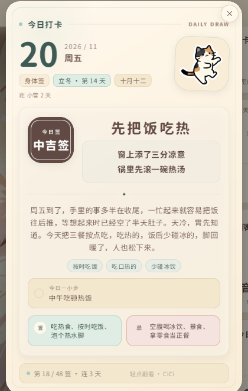
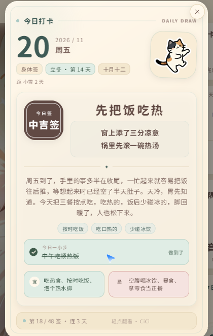
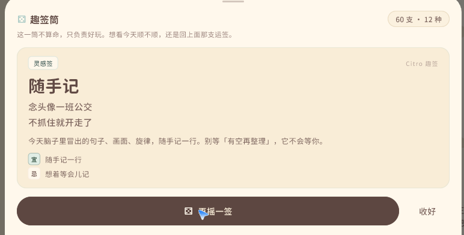
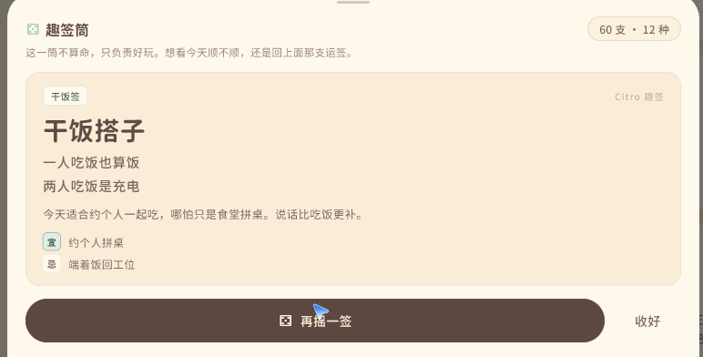
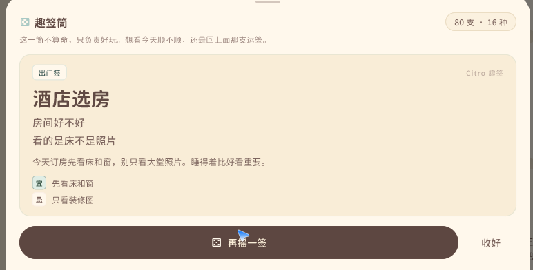

# Citro 打卡页 · 每日解签方案

> 打卡入口实际打开的是抽签 / 运势面板（`showCheckinOverlay` → `showFortuneOverlay`）。
> 本次把「8 支固定签 + 一段固定签文」扩成「48 支签 + 每日 AI 解签 + 今日一小步」，
> 让每天打开都有新内容，同时保留原有的翻牌动效、节日签与转运机制。



## 1. 原来的问题

| 项 | 原来 | 现在 |
| --- | --- | --- |
| 签的数量 | 8 支（每个等级只有 1 支） | 48 支（8 级 × 6 支） |
| 内容维度 | 只有吉凶 | 吉凶 + 10 种签类（事业 / 学业 / 心事 / 人际 / 身体 / 行动 / 钱袋 / 收工 / 灵感 / 小事） |
| 每日文案 | 固定，同等级每天一样 | 本地签池随机取签 + AI 结合当天上下文写解 |
| 可做的事 | 只看 | 多一条可勾选的「今日一小步」 |
| 签面信息 | 日期 / 节气 / 农历 / 猫贴纸 | 追加签类徽章、三个关键词、解签状态、签池进度 |

## 2. 48 支签池

数据结构在 `flutter/lib/data/fortunes.dart`：

- `kSignPools`：`List<List<SignCard>>`，外层下标即签等级（0 上上 → 7 下下），每级 6 支；每支含
  `id / kind / name / desc / yi / ji / step / poem`。
- `kFortuneKinds`：签类 id → 中文标签；`fortuneKindLabel()` 兜底「随手签」。
- `fortuneForDay(lvIdx, day, {salt, slot, owner})`：等级由后端随机抽，具体签也随机落在**同级六支**之一；
  - 服务端当天抽等级时一并抽 `slot`（0..5），客户端按 `slot` 取签；
  - 同一天反复打开 → 同一支签、同一段解；
  - 第二天重新随机，不再按日期逐日轮换；同等级可能连续撞同一支，也可能跳过某支；
  - 旧缓存/离线没有 `slot` 时，用日期 + 等级 + 账号散列一个稳定位置兜底，同样不形成可预测轮换；
  - `signIndex` 给出「第 N / 48 签」，让「签很多」这件事在签面上可见。
- 节日签仍走 `kFestivalFortunes`，优先于日常签，且不参与转运。

写签的三条自定约束（测试会卡）：
1. 诗句两行、每行七字；
2. 读签 40–90 字，写今天能核对的状态，不预测具体事件；
3. 「今日一小步」14–22 字、动词开头、当天十分钟内做得到，且不依赖别人、外出或购买。

## 3. AI 每日解签

### 3.1 系统提示词

独立在 `flutter/lib/fortune/prompt.dart` 的 `kFortuneSystemPrompt`，定位是「签房先生，不做算命，只做读签」。核心条款：

- **角色与可见信息**：只看得到日期、星期、农历节气节日、连续打卡天数、签等级 / 签类 / 原签文、卡面类别；看不到姓名、职业、位置，不许编。
- **写法**：签题 4–6 字白话有动作感；两句七言写景象不写命运；读签 70–110 字三句话（状态 → 从哪来 → 今天怎么做）；三个关键词要具体不要形容词；宜 / 忌各 ≤ 12 字、动词开头；签背一句 20–36 字收尾。
- **底线**：不预测具体事件；不宿命、不制造焦虑（凶签必须给缓冲动作）；不做医疗 / 投资 / 法律判断；不贴性格标签、不用谁都能套的巴纳姆句式；不出现 AI / 模型 / 提示词 / 分数；不用 emoji、英文、Markdown。
- **输出**：按固定顺序分段文本输出（`@@签题` → `@@诗` → `@@读签` → `@@关键词` → `@@今日一小步` → `@@忌` → `@@便签`），每段一个标记，不用 JSON、不用代码块；附「好 / 差」两个例子锚定风格。
- **兜底**：信息不足就按等级写，不要编造当天发生了什么。

系统提示词只管「怎么写」；用户消息由 `buildFortunePrompt()` 拼装，把当天上下文列成清单（日期、农历、节日、节气、连续天数、签等级与签类、原签题与签文、原宜忌、卡面类别），并明确「等级和签类不要改」。

### 3.2 生成与缓存

`flutter/lib/fortune/ai_sign.dart`：

- `FortuneAiSign`：`title / poem / read / keywords / do / dont / note / finished`，`isComplete` 要求签题非空且读签 ≥ 30 字；`finished` 区分流式中间帧和最后一帧。
- `parseSegmentedSign(raw, {partial})`：解析分段文本协议；`partial` 时签题 / 诗 / 读签可以边写边出，「今日一小步」要等下一段标记出现才显示，避免半截动作。
- `parseAiSign(raw)`：保留给旧缓存和模型不守协议时回退，容忍 ```json 围栏、前后解释、字段退化成字符串；清洗 `# * \`` 等 Markdown 符号；结构不成立返回 `null`。
- `FortuneAi.streamOrGenerate()`：先读旧 JSON 缓存，未命中就请求流式模型并逐段 `yield`；最后把带安全动作的完整结果写回 JSON 缓存，旧缓存与新缓存都能读。请求失败重试 1 次，仍失败返回空流，签面保持**灰线占位 + 一行「这一签还没解出来 · 重试」**，不退回签池文案，也不出现半真半假的文本。
- 走通用 `AiService.stream`（GLM 代理，独立 system，不经过 CiCi 身份包装），`maxTokens: 820`、`temperature: .8`。
- 「今日一小步」生成后还会过 `isReasonableStep`：拒绝要别人、要出门、要购买/预约、没有落点的动作；不合格就用本地签池或 `kFortuneFallbackSteps` 的手边动作兜底。
- 避免「人人都一样」：签池只有 8 个等级，同一天必然有人撞同一支签。所以请求里带一个**专属切口**（`fortuneAngleFor(owner, day, idx)` 按「账号 + 日期 + 签位」稳定取 9 个方向之一），让同签不同人读的不是同一段话；同一账号当天重开仍读到缓存里那一份。
- 抽签身份也按账号派生：`/api/draw*` 传 `_drawId`（`gid` 拼账号哈希），因为服务端按 deviceId + 日期 记一次，同一台设备换个人会直接拿回上一个人的签；云端打卡统计仍用 `gid`，不受影响。

### 3.3 面板上的呈现

`flutter/lib/overlays/fortune_sheet.dart`：

- 签类徽章进 `tags`（新增 `kind` 样式）；
- 签题 / 诗句 / 读签 / 关键词**只用签房先生写出来的**：没回来时是占位灰线，不显示本地签池文案；宜忌仍取签池（它属于这支签本身，不是 AI 写的解）；
- 读签下方追加三个关键词 chips；
- 「今日一小步」同样等 AI 写好再出现（14–22 字、十分钟内能做完的具体动作），按天记进打卡快照；没写好时只占位、不给按钮；勾掉后文字加删除线并显示「做到了」，跨天自动重置；
- 解签进行中显示一行「签房先生正在解这一签」，签题 / 诗 / 读签随 SSE 分段落字；失败则换成「这一签还没解出来 · 重试」，如果只回来半签也会给重试，不把残句留在签面上；
- 底部状态条改为「第 N / 48 签 · 连 M 天」。



## 4. 验证

- `flutter analyze lib/data/fortunes.dart lib/fortune lib/overlays/fortune_sheet.dart`：无 error。
- `test/fortune_pool_test.dart`（11 项）：48 支签唯一、签类全覆盖、诗句七字、文本长度、同日稳定、显式 slot 取签、不按日期轮换、签池序号区间、越界夹取、200 天随机完整性。
- `test/fortune_ai_sign_test.dart`（12 项）：严格 JSON、围栏与前后解释、字段退化、缺字段判空、非 JSON 不抛异常、Markdown 清洗、分段协议完整七段、流式半截动作不提前显示、分段失败回退 JSON、动作校验、兜底池校验、缓存键按天按等级区分。
- `test/fortune_angle_test.dart`（4 项）：同一人同一天切口稳定、换个人撞同签切口散开、换天切口会变、切口确实写进提示词。
- Windows debug 实跑：打开面板 → AI 解签落字 → 勾选今日一小步 → 关闭重开，内容与勾选状态都保持；同一天只请求一次。
- 手势细节：卡片本身的点击用 `onTapUp` 判断落点，落在「今日一小步」那一行时不翻面；小步的勾选用 `Listener` 处理，避免和外层卡片的手势竞技场抢事件（真机验证：点小步只切换勾选，卡片不动）。

## 5. 后续可做

- 签池扩到 96 支（每级 12 支），或按签类再加「个性签 / 节气签」专题池；
- 把解签结果做成可分享的签纸图；
- 连续打卡里程碑（7 / 30 / 100 天）触发特殊签面。

## 6. 趣签筒（80 支 · 16 种）

48 支签解决的是「今天顺不顺」，但印章永远只有上上签 … 下下签这 8 个名字，
看起来还是「八个签」。所以再挂一筒**趣签**：不看吉凶，只看今天像什么。



- 16 种：摸鱼 / 早八 / 干饭 / 熬夜 / 猫缘 / 社恐 / 打工人 / 出门 / 手机 / 学生 / 财迷 / 灵感 / 断舍离 / 天气 / 废话 / 反内耗，每种 5 支，共 80 支；
- 纯本地文案，不请求后端、不调用 AI，摇多少次都行；
- 与运签完全独立：不碰 `/api/draw`、不影响连续天数、不占转运次数；
- 首次打开按日期给一支固定签（`funSignOfDay`），之后由「再摇一签」随机取，且避开上一支；
- 入口在打卡面板最底部一条「还不过瘾？去趣签筒摇一支 · 80 支 · 16 种」，点开是从底部升起的签筒面板。





签面结构沿用运签的视觉语言，但换成签纸式的米黄底：签种小标 + 签题 + 两句打油诗 + 一句注解 + 宜 / 忌两个具体动作。
摇签时整张签纸左右轻摆两下，文字淡入，面板高度用 `AnimatedSize` 平滑过渡，不跳。

代码位置：

- `flutter/lib/data/fun_signs.dart`：`FunSign`、`kFunSignKinds`、`kFunSigns`（80 条）、`funSignOfDay`、`randomFunSign`、`funSignsOf`；
- `flutter/lib/overlays/fun_sign_sheet.dart`：`showFunSignSheet` 与签筒面板；
- `flutter/lib/overlays/fortune_sheet.dart`：底部入口与 `_funEntry`。

验证：

- `flutter analyze lib`：无 error；
- `test/fun_signs_test.dart`（8 项）：80 支 / 16 种 / 每种 5 支、id 与签题唯一、诗句与注解长度、宜忌非空且不同、同日稳定、80 天轮完、再摇不重复、每种至少一支命中主题词；
- Windows debug 实跑：打卡面板 → 底部入口 → 签筒面板 → 连摇数次（灵感签「随手记」、干饭签「干饭搭子」、早八签「早八迟到」等），签种随机切换正常。

后续可做：

- 签种筛选（今天只想摇「猫缘签」）；
- 收藏 / 分享单支趣签；
- 连摇 10 次解锁「签筒彩蛋」。